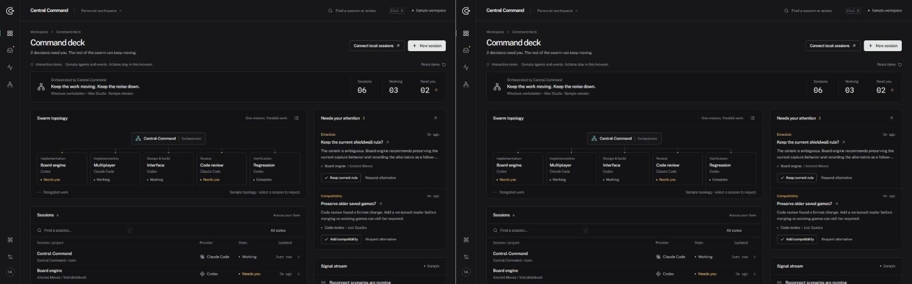

# Central Command

A graphical command deck for Claude Code and Codex sessions. This is a modified fork of **CloudCLI UI (https://github.com/siteboon/claudecodeui)**, built as a local proof of concept on October 29, 2026.



## Try it

Requires **Node.js 22+**, npm, and Git. Tested here with Node 24.22.1 on Windows.

```sh
git clone https://github.com/TommyAllsup/central-command-gui.git
cd central-command-gui
node scripts/central-command-setup.mjs
node scripts/central-command-start.mjs
```

Open **http://127.0.0.1:4311**. This checkout is already installed and built, so only the last command is needed on this PC. Windows users can double-click `scripts/central-command-start.cmd`.

The setup/launcher scripts handle this machine's oversized Windows PATH without changing system settings. They bind to localhost and use `~/.central-command/auth.db`, separate from another CloudCLI installation. Stop with Ctrl+C.

For development: `node scripts/central-command-start.mjs --dev` serves the GUI at **http://127.0.0.1:4310**. Keep its terminal open.

## Five-minute morning tour

1. Start in the **sample workspace**. Select a node in the swarm map, or search for a session with `/`.
2. Resolve a decision in **Needs your attention**. Its owner changes state, the count updates, and the response appears in the signal stream. Refresh: the demo remembers it.
3. Open **Signal stream**. Filter decisions, completions, or unread signals; mark the sample signals read.
4. Create a sample session with **New session**, inspect it, and try **Ctrl+K** (Cmd+K on Mac). **Reset demo** restores the original scenario.
5. Choose **Connect local sessions**. Create your local GUI account on first use; then inspect discovered sessions. Open one to use the inherited chat, terminal, files, Git, and provider permission controls. The workspace sidebar has a **Command deck** return link.

The local account is separate from Claude/Codex sign-in. Authenticate those providers through their normal CLI/workspace flows before asking them to run work.

## What works in this POC

| Capability | Implementation |
| --- | --- |
| Command deck, session inspector, search, state filter | Working UI |
| Sample orchestrator hierarchy, decision inbox, pause/resume, drafts | Interactive demo; browser-local persistence; no agent process |
| Signal triage | Demo decisions/completions/unread filters and mark-read action |
| Local session discovery | Authenticated CloudCLI APIs; recent 40 plus older active sessions; 15-second refresh |
| Existing session conversations and control | Inherited CloudCLI workspace at `/workspace` and `/session/:id` |
| Windows launch, native database, production build | Verified locally; details in [TESTING.md](docs/TESTING.md) |
| macOS support | Inherited portable stack and launch scripts; not executed on a Mac in this run |

**Boundaries:** Mac Studio and Windows workstation in the sample workspace are fictional hosts. The live view connects only to the machine running the server. It does not attach to cmux panes, connect two machines, launch an autonomous central orchestrator, or aggregate real approval requests. Real approvals remain in the original session workspace. `History` means the backend has not reported an active run; it does not prove an external Codex process is stopped. No paid inference was performed during validation. This is a local POC, not a finished desktop release or an audited network service.

## Why this fork

Eight alternatives were researched. CloudCLI offered the shortest route to a working cross-provider POC: React/Vite, Node/Express, Claude and Codex adapters, local session discovery, streaming, and existing Windows/macOS packaging.

- [Research and license comparison](docs/RESEARCH.md)
- [Implementation plan and next stages](docs/PLAN.md)
- [Design direction and visual checks](docs/DESIGN.md)
- [Validation, startup details, and limitations](docs/TESTING.md)
- [Original upstream README](docs/UPSTREAM-README.md)

The visual direction uses the taste skill's **Data terminal** style, seed `850472389`: Public Sans, IBM Plex Mono for figures, neutral dark surfaces, restrained teal selection marks, and a task hierarchy specific to Central Command. Fonts and their OFL licenses are bundled locally.

The next useful milestone is an authenticated Mac host bridge with stable session identity and a durable decision/event queue. Build that before remote command dispatch or desktop installers; the plan describes the sequence.

## Development

```sh
npm run typecheck
npm run test:client
npm run build
npm run lint
```

If npm commands hit Windows PATH-length errors, use the setup script or the `commandEnvironment()` helper in `scripts/central-command-env.mjs` for child processes. This repository retains upstream test suites and adds focused tests for Central Command's live mapping, demo state, UI behavior, and workspace navigation.

## License and origin

AGPL-3.0-or-later with the upstream Section 7 terms. Modification is permitted subject to those terms; this is not a permissive MIT/Apache project. [LICENSE](LICENSE) and [NOTICE](NOTICE) are retained. Central Command is a modified fork, not an endorsed Siteboon product. Its source is available in [this repository](https://github.com/TommyAllsup/central-command-gui), and the interface retains the required CloudCLI UI attribution and source link.
