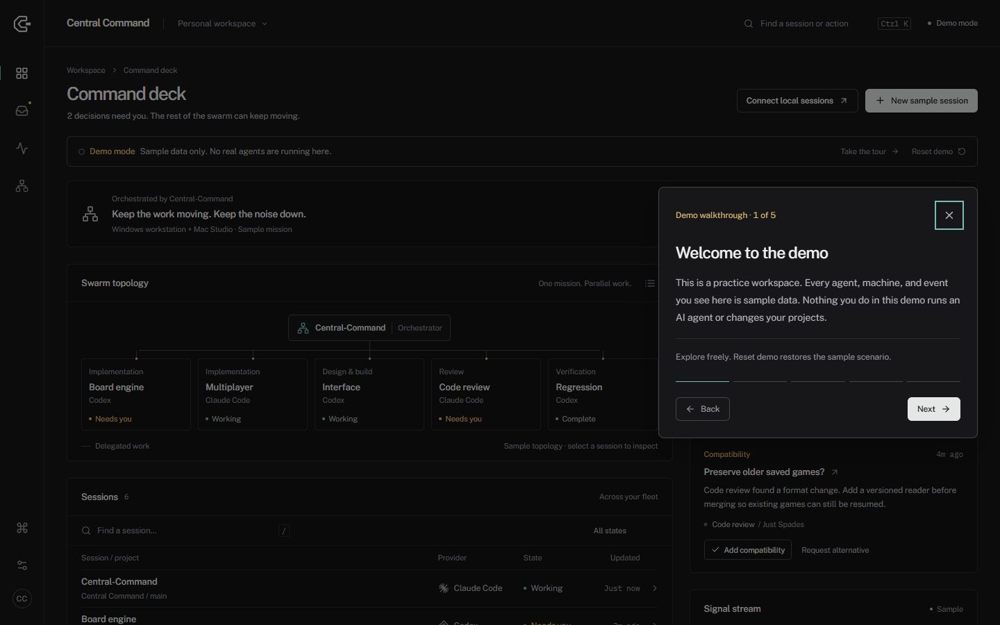

# Central Command

A local command deck for Claude Code and Codex. Find the session that needs you, inspect its work, and keep routine output out of the way.

**Developer preview:** each teammate runs their own local instance. The first screen is a guided demo with sample data. Connect local sessions when you are ready to use your own projects.



## Install and run

You need **Git and Node.js 22 or newer (with npm)**. Claude Code or Codex is needed for live work, but not for the demo.

Run in Terminal on macOS or PowerShell on Windows:

```sh
git clone https://github.com/TommyAllsup/central-command-gui.git
cd central-command-gui
node scripts/central-command-setup.mjs
node scripts/central-command-start.mjs
```

Open **[http://127.0.0.1:4311](http://127.0.0.1:4311)**. Keep the terminal open; Ctrl+C stops the app.

**Next time:** run `node scripts/central-command-start.mjs` from the same folder. Windows users can also double-click `scripts/central-command-start.cmd`.

### Connect your real sessions

1. Complete or skip the demo walkthrough. **Take the tour** replays it at any time in demo mode.
2. Select **Connect local sessions** and create your local GUI account. This is separate from your Claude or OpenAI account.
3. Open the workspace and select a provider and project. Use your existing provider sign-in; complete any required sign-in yourself.
4. Open a session for its conversation, terminal, files, Git tools, and permission prompts. The sidebar's **Command deck** link returns to the overview.

Demo decisions and drafts stay in your browser and never run an agent. Live work uses your provider account and its normal permissions and usage limits.

## Let your agent set it up

Copy this into your coding agent:

> Set up Central Command from https://github.com/TommyAllsup/central-command-gui on this machine. Read docs/AGENT-SETUP.md and follow it. Check prerequisites, preserve existing local changes, install/build, start the local app, and verify the page and health endpoint. Tell me the URL and any provider sign-in steps I need to complete. Do not send an AI prompt, change my credentials, or expose the server to the network.

The [agent setup guide](docs/AGENT-SETUP.md) includes verification, restart, and troubleshooting steps.

## What works today

| Area | Demo mode | Live local mode |
| --- | --- | --- |
| Command deck | Sample swarm, missions, and machine names | Recent sessions plus runs reported active by the local backend |
| Session inspector | Example briefs and sample pause/resume | Open the full session workspace to continue work |
| Decision inbox | Accept a sample direction or request an alternative | Real approvals remain in the session workspace |
| Signal stream | Filter decisions, completions, and unread sample events | Recent local session activity, refreshed every 15 seconds |
| Session creation | Draft a sample session without running an agent | Create work through the provider workspace |

Search with `/`. Open the palette with **Ctrl+K** or **Cmd+K**. **Reset demo** restores sample data without changing real sessions, your account, or your tour preference.

## Roadmap and fork expectations

We are building an attention and coordination layer over CloudCLI's provider runtime. We intend to retain its working adapters, follow relevant upstream fixes, and contribute reusable fixes upstream where practical.

Next: reliable Windows/Mac onboarding, a durable live decision queue, an authenticated Mac/cmux bridge, deliberate orchestration, and signed desktop distribution. These are milestones with acceptance criteria, not delivery-date promises.

Read the [roadmap and fork commitments](docs/ROADMAP.md) and [developer-preview release checklist](docs/RELEASE.md).

**Current limits:** no shared team account or multi-user server, remote-machine control, direct cmux attachment, or automatic delegation. `History` means no active run was reported; it does not prove an external CLI process stopped. Windows has been validated; Mac and real provider-turn acceptance checks remain pending. Keep this preview local while we complete those checks and assess inherited dependency findings.

## Updating and troubleshooting

For a clean checkout: stop the server, run `git pull --ff-only`, rerun setup, then start again. Preserve local changes before updating.

- **Missing Node/npm:** install Node.js 22+ with npm, reopen the terminal, and retry.
- **Native dependency build failure:** inspect the first error. Mac may need Xcode Command Line Tools; Windows may need C++ Build Tools. See [troubleshooting](docs/AGENT-SETUP.md#troubleshooting).
- **Port occupied:** reuse the running instance or set `CENTRAL_COMMAND_PORT` to an available port.
- **No sessions:** verify provider sign-in and project selection in the workspace. Demo hosts are never real connections.

The launcher listens on localhost and stores its account database at `~/.central-command/auth.db`, separate from other CloudCLI installations. See [TESTING.md](docs/TESTING.md) for diagnostics and validation evidence.

## Development and background

Run `node scripts/central-command-start.mjs --dev` for development at **http://127.0.0.1:4310**. Checks: `npm run typecheck`, `npm run test:client`, `npm run build`, and `npm run lint`.

[Research](docs/RESEARCH.md) · [Design](docs/DESIGN.md) · [Original POC plan](docs/PLAN.md) · [Upstream documentation](docs/UPSTREAM-README.md)

## License and origin

Central Command is a modified fork of **CloudCLI UI (https://github.com/siteboon/claudecodeui)**, licensed under **AGPL-3.0-or-later with the upstream Section 7 terms**. [LICENSE](LICENSE) and [NOTICE](NOTICE) are retained. Modification is permitted subject to those terms. This fork is not endorsed by Siteboon. Corresponding source is available in [this public repository](https://github.com/TommyAllsup/central-command-gui).
